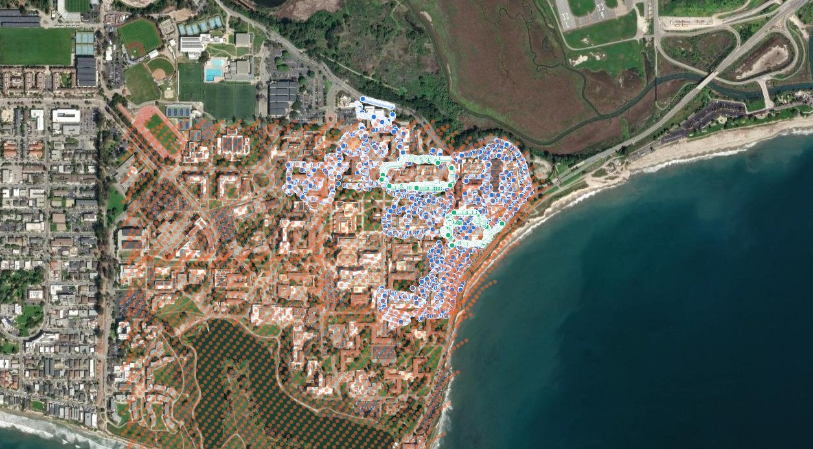
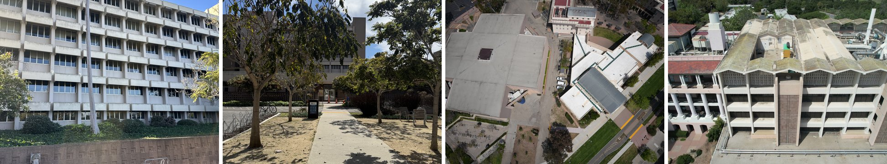
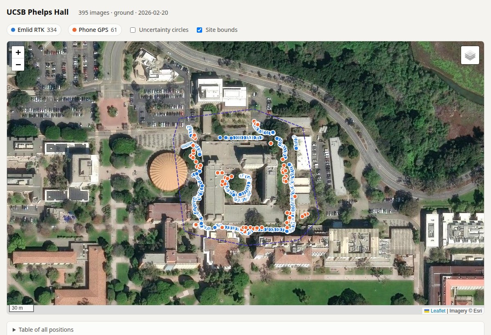
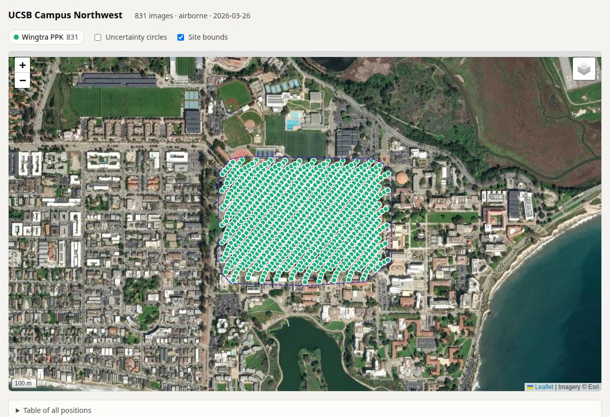

# UCSB in 3D

Data tooling for a 3D digital twin of the **UC Santa Barbara campus**: phone photos of
buildings, drone surveys and drone video, organized into georeferenced collections that feed
point-cloud and Gaussian-splat reconstruction.



<sub>All 64 collections on one map. Blue: ground photos walked around each building. Orange:
WingtraOne survey flights. Green: DJI video orbits. Generated by `tools/overview_map.py`.
Imagery © Esri.</sub>

## Goal

A public **"UCSB in 3D"** site in the spirit of [JHU in 3D](https://cpeng93.github.io/JHU-in-3D/):
a campus-wide aerial Gaussian splat plus ground and aerial splats for each building, with
fly-through camera paths, building labels and jumps between aerial and ground views.

**First version live:** <https://chandrakanth-gudavalli.github.io/uc_santa_barbara_3d/>. It has six scenes: two
campus drone surveys, two building walks (Harold Frank Hall, Engineering Science Building) and two combined
ground + air models, with an opening flythrough, photo-view stepping and jumps between the air and the ground. The page is in
[`site/`](site/); the splat files are on Hugging Face ([wrivachand/uc_santa_barbara_3d](https://huggingface.co/wrivachand/uc_santa_barbara_3d)).

This repo covers the first stage: getting every image onto a common footing, with a position,
a timestamp and camera parameters, so reconstructions can be trained and aligned on one campus
coordinate frame.

## The data at a glance

| Folder | What | Collections | Images | With GPS | cm-level GPS |
|---|---|---:|---:|---:|---:|
| `Ground/` | iPhone photos walked around 20 buildings (+ 3 older captures) | 23 | 6,926 | 6,026 | 4,631 |
| `drone/` | WingtraOne fixed-wing survey flights, Sony 61 MP nadir | 9 | 4,490 | 4,490 | 831 |
| `DJI/` | Keyframes (~1 fps) from 32 DJI drone videos | 32 | 5,517 | 5,514 | 0 |
| **Total** | | **64** | **16,933** | **16,030** | **5,462** |

The cm-level positions come from an **Emlid Reach RX2 RTK** receiver carried during the ground
captures (matched to each photo by capture time) and from **PPK** processing of the Northwest
Wingtra flight. Everything else has phone, onboard or DJI GPS at the metre level. Per-collection
numbers are in [`docs/collections_summary.csv`](docs/collections_summary.csv) and
[`docs/COLLECTIONS.md`](docs/COLLECTIONS.md).



<sub>Left to right: Phelps Hall and Henley Hall from the ground, a Wingtra nadir image over
northwest campus, a DJI oblique video frame.</sub>

## Collection format

Each collection follows the layout of the WRIVA program's image datasets (metadata schema 4.2.0):

```
wriva_format/{Ground,drone,DJI}/<collection>/
├── images/image_000001.jpg …     full-resolution copies, in capture order (HEIC → JPEG)
├── metadata/image_000001.json …  per-image metadata
├── metadata/site.json            site bounds polygon, timezone, notes
├── manifest.csv                  each image → its original file, GPS source, extras
└── gps_map.html                  interactive map of the image positions
```

A per-image record, abridged:

```json
{
  "version": "4.2.0",
  "fname": "image_000100.jpg",
  "site": "UCSB Phelps Hall",
  "source": "Apple iPhone 14 Pro Max",
  "timestamp": 1771630633.866,
  "extrinsics": { "lat": 34.41576531, "lon": -119.84363582, "alt": -21.052,
                  "omega": null, "phi": null, "kappa": null },
  "extrinsic_uncertainty": { "lat": 0.011, "lon": 0.011, "alt": 0.024 },
  "extrinsic_calibration": "emlid_rtk",
  "intrinsics": { "fx": 2795.7, "fy": 2795.7, "cx": 2016.0, "cy": 1512.0, "rows": 3024, "columns": 4032 },
  "type": "ground"
}
```

`alt` is WGS84 ellipsoidal height in every collection (about −20 m at ground level on campus).
`extrinsic_calibration` names where the position came from:

| Source | Accuracy | Used for |
|---|---|---|
| `emlid_rtk` | 1–3 cm | ground photos within 5 s of an Emlid RTK point |
| `wingtra_ppk` | 2–3 cm | Northwest flight |
| `device_gps` | 5–15 m | other ground photos (phone EXIF) |
| `wingtra_gnss` | ~5 m | other Wingtra flights (onboard GNSS) |
| `dji_gps` | several m | DJI keyframes (SRT telemetry) |
| `none` | — | 903 images with no position |

Full details: [`docs/WRIVA_FORMAT.md`](docs/WRIVA_FORMAT.md).

## GPS maps

Every collection ships with a `gps_map.html`: positions on satellite imagery, coloured by GPS
source, with uncertainty circles, a click-to-preview popup and a table of every position.

| Phelps Hall (ground) | Northwest flight (drone) |
|---|---|
|  |  |
| 334 Emlid RTK positions (blue) follow the walkways; the 61 phone-GPS positions (orange) scatter several metres off them. | 831 PPK-positioned images in the flight's survey grid. |

## Quick start

The data lives on the workstation's `/data_8tb` drive; this repo holds the tooling and docs.

```bash
python3 -m venv .venv && .venv/bin/pip install -r tools/requirements.txt   # Pillow, pillow-heif, openpyxl

.venv/bin/python tools/build_wriva.py --list                 # all 64 collection names
.venv/bin/python tools/build_wriva.py ucsb_phelps_ground     # build one (skips existing folders)
.venv/bin/python tools/summarize_collections.py              # refresh docs/collections_summary.csv
.venv/bin/python tools/overview_map.py                       # refresh the campus overview map
```

## Repository layout

| Path | What |
|---|---|
| [`tools/build_wriva.py`](tools/build_wriva.py) | builds the collections: Emlid-to-photo matching, HEIC conversion, Wingtra and DJI geotags |
| [`tools/gps_map.py`](tools/gps_map.py) | per-collection `gps_map.html` |
| [`tools/overview_map.py`](tools/overview_map.py) | campus-wide `overview_map.html` |
| [`tools/summarize_collections.py`](tools/summarize_collections.py) | `collections_summary.csv` |
| [`docs/DATA_LOCATIONS.md`](docs/DATA_LOCATIONS.md) | where every raw and processed dataset is on `/data_8tb`, and known duplicates |
| [`docs/WRIVA_FORMAT.md`](docs/WRIVA_FORMAT.md) | the collection format, GPS sources, altitude datum, sources per collection |
| [`docs/COLLECTIONS.md`](docs/COLLECTIONS.md) | inventory of all collections and their gaps |
| [`site/`](site/) | the "UCSB in 3D" web viewer (three.js + [Spark](https://sparkjs.dev)), published by [`.github/workflows/pages.yml`](.github/workflows/pages.yml) |
| [`CLAUDE.md`](CLAUDE.md) | working notes and conventions for contributors (and Claude Code) |

## Roadmap

- [x] Locate and document all campus imagery on `/data_8tb`
- [x] Organize ground, Wingtra and DJI imagery into georeferenced WRIVA-format collections
- [x] Per-collection and campus-wide GPS maps, summary CSV
- [ ] Point clouds and Gaussian splats per building, plus a campus-wide aerial splat (first six scenes on the site)
- [ ] PPK for the remaining Wingtra flights (North Middle, Northeast, East, Lagoon)
- [x] The "UCSB in 3D" web viewer, first version (`site/`, splats hosted on Hugging Face)
- [ ] More buildings, building labels, fly-through camera paths, level-of-detail streaming for phones
